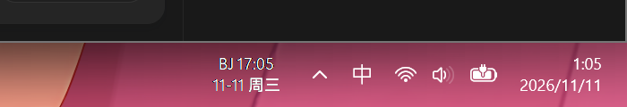

# BJClock

极轻量 Windows 北京时间任务栏悬浮时钟。保留系统原时区，离线显示 UTC+8。



## 功能

- Python 标准库 `tkinter + ctypes`，无第三方依赖。
- 使用 `datetime.now(timezone.utc) + timedelta(hours=8)`，每秒刷新，不受美国夏令时影响，不调用网络 API，也不修改系统时区。
- 无边框、透明背景、始终置顶、不生成任务栏图标；使用 `WS_EX_LAYERED | WS_EX_TRANSPARENT | WS_EX_TOOLWINDOW | WS_EX_NOACTIVATE`，鼠标点击穿透，不抢焦点。
- 两行显示 `BJ HH:mm` 和 `MM-dd 周X`。
- Segoe UI Variable Display 9pt，缺失时回退 Segoe UI，颜色适配 Windows 深浅主题。
- 读取主任务栏位置及 DPI，支持偏移热更新与单实例运行。

## 环境与安装

Windows 10/11（64 位），Python 3.9+，需带 `tkinter` 和 `pythonw.exe`。本项目实际验证环境为 Windows、Python 3.12、3840×2160、150% 缩放；其他环境尚未验证。

在项目目录执行：

```powershell
powershell -NoProfile -ExecutionPolicy Bypass -File .\install.ps1 -PythonExe "C:\path\to\python.exe"
```

如果 `python.exe` 已在 PATH，也可省略 `-PythonExe`。安装脚本会：

1. 检查 Python 及 tkinter，停止已有时钟。
2. 将脚本安装至 `%UserProfile%\.bjclock\`，保留已有配置。
3. 生成无黑框的 `Restart.vbs`、`Stop.vbs`。
4. 在当前用户的 Startup 文件夹创建 `Beijing Clock.lnk` 并启动时钟。

Startup 在用户登录后运行；实际注销/重启自启尚未验证。若删除或移动 Python 解释器，需用新的路径重新安装。

## 调整位置

编辑 `%UserProfile%\.bjclock\config.json`，保存后约一秒生效：

```json
{
  "mode": "left",
  "x_offset": 0,
  "y_offset": 0,
  "gap": 8,
  "color": "auto"
}
```

| 配置 | 含义 |
| --- | --- |
| `mode: "left"` | 放在系统托盘区域左侧，原美国时间和 BJ 之间仍有托盘图标 |
| `mode: "above"` | 放在原美国时钟上方；无法获取独立时钟窗口时，按右端位置估算，可通过偏移微调 |
| `x_offset` | 正数右移，负数左移 |
| `y_offset` | 正数下移，负数上移 |
| `gap` | 与托盘或任务栏的间隔 |
| `color` | `"auto"` 随系统主题，或 `"#ffffff"` 固定白色 |

偏移与间隔单位为 96 DPI 逻辑像素，自动乘缩放比例。例如 150% 缩放下，偏移 10 对应 15 个物理像素。

也支持命令行参数（优先于配置文件）：

```powershell
pythonw.exe .\bjclock.py --mode above --x-offset -10 --y-offset -2
pythonw.exe .\bjclock.py --stop
python.exe .\bjclock.py --diagnose
```

安装目录中双击 `Stop.vbs` 停止，`Restart.vbs` 重启。

## 验证与限制

已核验实际截图、窗口可见性/位置/扩展样式/透明色、单实例、配置热更新及 above 模式。尚未进行真实鼠标点击、重启、多屏切换或任务栏自动隐藏测试。主要面向主屏幕底部的水平任务栏；始终置顶窗口也可能显示在全屏应用上。

运行时会在安装目录生成 `status.json`（最近一次位置变化的快照）、`error.log`（异常）或 `config-error.txt`（配置错误）。这些文件不进入版本控制。

## 卸载

先运行 `Stop.vbs`，再删除 Startup 文件夹中的 `Beijing Clock.lnk` 和 `%UserProfile%\.bjclock\`。

原生窗口行为参考：[Microsoft Window Features](https://learn.microsoft.com/en-us/windows/win32/winmsg/window-features)。
